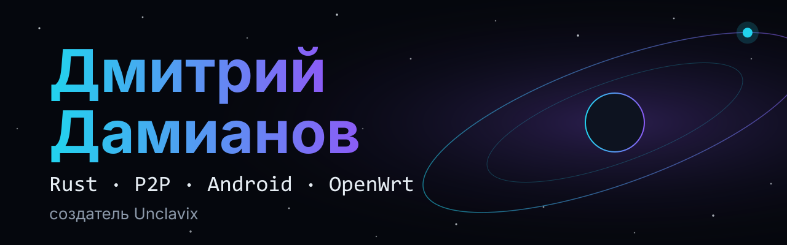
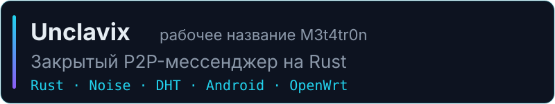
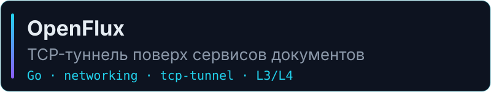
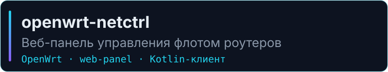
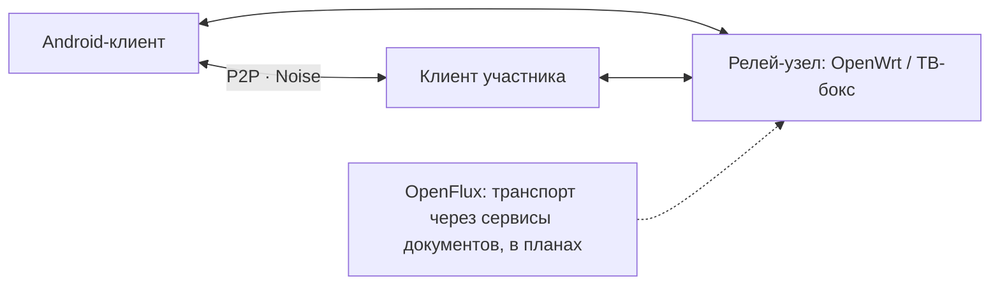

  

**Дмитрий Дамианов (imbazyx)** — инженер. Делаю закрытый P2P-мессенджер **Unclavix** на Rust: E2E-шифрование, клиенты для Android, узлы на OpenWrt. Беру заказы на Telegram-ботов, Android-приложения и веб-панели.

  
  
  

## · ✦ · Что я строю

Android-клиент в работе, клиент для ПК в разработке. Код закрыт, доступ по приглашениям.

Транспортный слой: подключаемые транспорты и бэкенды выхода L3/L4. Открытый код.

Веб-панель флота роутеров OpenWrt и [Android-клиент](https://github.com/imbazyx/openwrt-netctrl-android) к ней. Открытый код.

## · ✦ · Как устроен Unclavix

- Личные сообщения шифруются на устройствах участников (Ed25519 · X25519 · AES-256-GCM), ключи остаются у них.
- Релей помогает установить соединение и хранит только зашифрованные данные. Состав ленты и сообществ сервер видит.
- Регистрации нет, доступ по приглашениям.

## · ✦ · Стек

  
  
  
  
  
  

## · ✦ · Беру заказы

Telegram-боты · Android-приложения · веб-панели и сайты. Как работаю: **бриф** → **план и сроки** → **разработка с промежуточными демо** → **передача с инструкциями и поддержкой**.

## · ✦ · English

**Dmitry Damianov** — engineer behind Unclavix, a closed P2P messenger in Rust. Also available for Telegram bots, Android apps and web panels.
Rust · Kotlin · Go · OpenWrt · Linux.

<a href="https://t.me/imbazyx"><b>Написать в Telegram →</b></a>

Unclavix разрабатывается в исследовательских целях.